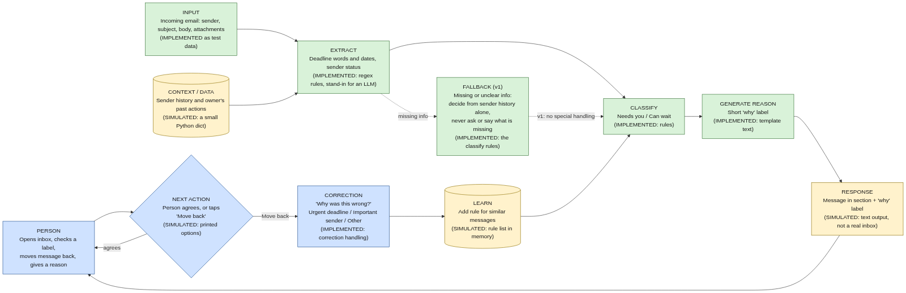
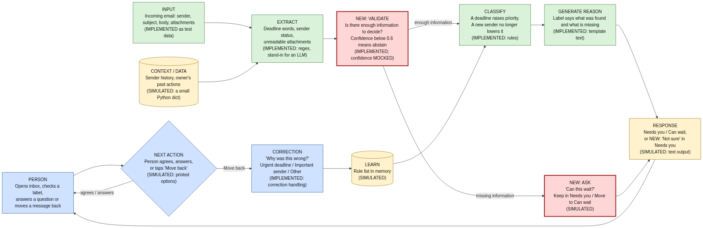

# 01_SPEC.md: use case and system path

Use case: failure and recovery. An AI email-triage assistant wrongly puts an urgent message from a new sender into "Can wait". The person notices, checks the reason, moves it back and tells the system why.

Files in this submission: `01_SPEC.md` (this file), `diagrams/system_path_v1.png` and `diagrams/system_path_v2.png` (with `.mmd` Mermaid sources), `simulation/triage_sim.py` (runnable prototype), `simulation/simulation_output_v1.md` and `simulation/simulation_output_v2.md` (output of both runs), `storyboard-email-triage.png` (the failure-and-recovery storyboard of this use case), `02_PROMPT_LOG.md`.

Labels used throughout: IMPLEMENTED = runs as code in `triage_sim.py`; SIMULATED = printed text or an in-memory stand-in; MOCKED = invented numbers or a stand-in for a real model; PLANNED = not built.

## User goal
Get through the inbox quickly without missing anything important, and be able to check why a message was sorted and put it right when the assistant is wrong.

## System inputs
- From the system's side, the "request" is an incoming email: sender, subject, body and attachments.
- Context the system holds: what the owner has done with that sender before (replies, opens), and rules learned from earlier corrections.
- From the person: taps on a "why" label, "Move back to Needs you", and a reason chosen from "Urgent deadline", "Important sender" or "Other" (free text).

## Processing and technology
| Step | What it does | Component | Status |
|---|---|---|---|
| Extract | Finds deadline words and dates, checks whether the sender is known, flags unreadable attachments | Regex rules in `triage_sim.py`. In a real product an LLM or a small trained model would do this; a regex is used here so the run is repeatable | IMPLEMENTED (stand-in for an LLM) |
| Look up | Reads sender history | A small Python dict. A real system would query the mail store | SIMULATED |
| Validate (new in v2) | Checks whether there is enough information to decide | Confidence formula with a threshold of 0.6 | IMPLEMENTED; the confidence numbers are MOCKED |
| Classify | Chooses "Needs you" or "Can wait" | Rule list | IMPLEMENTED |
| Generate reason | Writes the short "why" label | Template text. An LLM could phrase it, but a template cannot invent a reason that was not used | IMPLEMENTED |
| Learn | Stores a rule after a correction | A list in memory | SIMULATED |

Known limit of the regex stand-in: it only recognises a few deadline phrasings (for example "by Thursday 5pm", "asap", "urgent"). A phrase such as "end of play Thursday" would be missed, which is one reason an LLM is listed as the better choice for real mail.

Why rules and not an LLM for classification: the reasons must match what was actually used. A rule can show its real inputs. An LLM-written reason could sound right without being the true cause. An LLM would still be the better choice for extraction on real, messy mail (PLANNED).

## Intended result and next action
The message appears in a section with a short "why" label. The person can leave it, tap the label to read the reason, or tap "Move back to Needs you". After a move, the system asks "Why was this wrong?" and learns from the answer. The learned rule applies to a pattern (deadline words from a new sender), not to one sender only. Nothing is deleted or sent by the system.

## Fallback strategy
- Version 1 (as first specified): the only fallback is to decide from the sender's history alone. The system never asks for missing information and never says that something could not be read.
- Version 2 (after review): if there is too little information to decide (confidence below 0.6), the message stays in "Needs you" marked "Not sure", the label lists what is missing, and the person is asked "Can this wait?".
- Out of scope (for example "delete everything from the landlord"): the system should say it cannot do that. Version 2 still does not (open issue, see Phase 4).
- Data unavailable (for example an unreadable attachment): v2 names it in the label. A full model or history outage is not simulated yet (PLANNED).

## System path or interaction diagram
Version 1: `diagrams/system_path_v1.png`. Version 2 (new parts outlined in red and marked NEW): `diagrams/system_path_v2.png`.

Path in words, version 2: email arrives -> extract (deadline, sender, attachments) with sender history -> validate -> if enough information, classify and write the reason; if not, ask "Can this wait?" -> response in the inbox -> person agrees, answers, or taps "Move back" -> correction question -> learn -> classify later messages.

## Test A: standard input
Input: first-ever message from "Landlord", subject "Rent review - reply by Thursday", body "Hi, we are reviewing rents. Please reply by Thursday 5pm to confirm you are happy to continue. Thanks." Then, after the correction, a second message from a different new sender: "Please confirm by Friday that Saturday morning works for the inspection."

What the system receives: the message fields; no sender history; no learned rules (A1), then one learned rule (A2).

What it does (v1): extracts "by Thursday 5pm" (confidence 0.8, mocked) but the classifier rule "new sender -> Can wait" fires, so the deadline is ignored. After the person corrects it with "Urgent deadline", the system adds the rule "deadline + new sender -> Needs you". The second message is then sorted correctly.

Response and next action: A1 goes to "Can wait" with the label "New sender, no past replies"; the person can tap the label or "Move back". After the correction the system says "Got it. I'll show messages like this in Needs you." A2 goes to "Needs you" with the label "Deadline from a new sender (learned from your correction)". Full run: `simulation/simulation_output_v1.md`.

## Test B: problem input
Input B1: first-ever message from "J. Smith", subject "Quick thing", body "Hi, could you take a look at this when you get a chance? Thanks, J", attachment `scan_0042.pdf` (not readable by the system).
Input B2 (out of scope): the person chooses "Other" and types "delete everything from the landlord".

What the system receives: B1: message fields, one unreadable attachment, no sender history. B2: the option "Other" plus free text.

What it does (v1): B1: extracts no deadline, flags the unreadable attachment, calculates a confidence of 0.3 and then does not use it; the rule "new sender -> Can wait" fires. B2: stores the free text without parsing it; no deletion exists and no rule is added.

Response and next action: B1 goes to "Can wait" with the label "New sender, no past replies", so the person has to go looking for it; nothing says the attachment could not be read. B2: "Got it. I'll show messages like this in Needs you." The person cannot do anything further and is not told that nothing happened.

## Review and revision

### Phase 3 review of Test A and Test B (version 1)
| Question | Verdict | Evidence | Problem found |
|---|---|---|---|
| Did the system make clear what it can and cannot do? | No | B2: the reply "Got it. I'll show messages like this in Needs you." follows a request to delete mail, which the system cannot do. B1: nothing says the attachment was unreadable. | Interaction: scope is never stated. |
| Did it show what it understood or extracted? | Partly | A1: the system extracted "by Thursday 5pm" but the label only says "New sender, no past replies". | System and interaction: the deadline was extracted but never shown, and the label shows only the reason that led to the wrong result. |
| Could the person correct a wrong extraction or decision? | Partly | A1/A2: "Move back" plus "Urgent deadline" works and A2 shows the system learned. There is no way to correct what was extracted, and "Other" free text is not understood (B2). | Interaction: decisions can be corrected, extractions and free text cannot. |
| Did it ask for missing information instead of guessing? | No | B1: confidence 0.3 was calculated, deadline missing, attachment unreadable, yet the system sorted it into "Can wait". | System and interaction: it guesses. The confidence value is computed but never used. |
| Did it keep the person in control of the next action? | Partly | "Move back" is always offered and nothing is deleted. But B1 is hidden in a section the person may not open (the person has to find it). | Interaction: the default hides the uncertain message. |
| Did it respond honestly when a model, tool or data source was unavailable? | No | B1: the unreadable attachment is silently ignored. B2: a false confirmation. | System and interaction: unavailable data is hidden. |

Ranked problems: (1) B1, the system guesses silently instead of asking (questions 4 and 6; interaction and system; harms the person, who may miss a message, and a delegate who cannot tell what was missing). (2) B2, a false confirmation for an out-of-scope request (questions 1 and 6; interaction). (3) A1, the extracted deadline is never shown and a new sender lowers priority (question 2; system and interaction).

Problem chosen for Phase 4: problem 1. It is serious, it can be fixed with one interaction change and one system change, and it is testable by re-running Test B.

### Phase 4 revision
Interaction change: when the system does not have enough information, it no longer guesses. The message stays in "Needs you" with a "Not sure" label that says what was found and what is missing ("Not sure: no deadline found; could not read attachment scan_0042.pdf; new sender"), and the person is asked "Can this wait?" with the buttons "Keep in Needs you" and "Move to Can wait". Options considered: a banner at the top of the inbox (less specific), a confirm dialog on every message (too much effort), or this inline question (chosen: it appears only when needed).

Technology and system change: a new VALIDATE step between extraction and classification. It checks the confidence against a threshold of 0.6 and counts unreadable attachments as missing information. The "new sender -> Can wait" rule is removed, so a deadline now raises priority and no longer depends on a past correction. Alternatives considered: an OCR step to read the attachment (would reduce the missing information but cannot guarantee it); a trained, calibrated classifier (more accurate, but needs data and has privacy cost). The validation step is the smallest change that stops the guess, so I chose it. The confidence formula and the 0.6 threshold are MOCKED and would need testing on real mail.

Updated diagram: `diagrams/system_path_v2.png`.

Test B re-run (same inputs as before; full output in `simulation/simulation_output_v2.md`):

| | Before (v1) | After (v2) |
|---|---|---|
| B1: what the system did | Rule "new sender -> Can wait" fired; the confidence of 0.3 was calculated and ignored | Validation found confidence 0.3, below 0.6, and abstained |
| B1: what the person sees | "Can wait" with the label "New sender, no past replies" | "Needs you (Not sure)" with the label "Not sure: no deadline found; could not read attachment scan_0042.pdf; new sender" |
| B1: next action | Leave it, tap the label, or "Move back" (and they have to find it first) | Message stays visible; choose "Keep in Needs you" or "Move to Can wait" |
| B2: what the person sees | "Got it. I'll show messages like this in Needs you." | Unchanged (open issue) |

Regression check on Test A: with the new deadline rule, A1 is now sorted into "Needs you" the first time ("Deadline found: by Thursday 5pm"), so the correction loop is no longer triggered in the run. The correction code was not changed but was not exercised in v2.

Why the changes help: the system now says when it does not have enough information, instead of hiding an uncertain message behind a confident-looking label, and the person decides whether it can wait. The label also tells the person what is missing, including the unreadable attachment, so the unavailable data is no longer hidden. These claims rest on a small rule-based simulation with mocked confidence numbers and two test inputs, so they show that the path behaves as designed, not that real users would find it better.

Open issues: B2 still gives a false confirmation (problem 2, not fixed in this revision); the model, the history lookup and the real inbox are not built.
